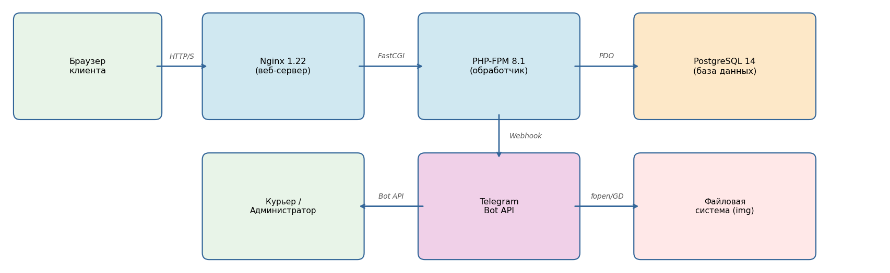
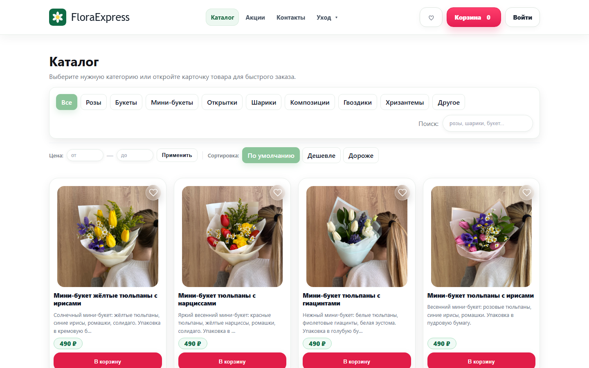
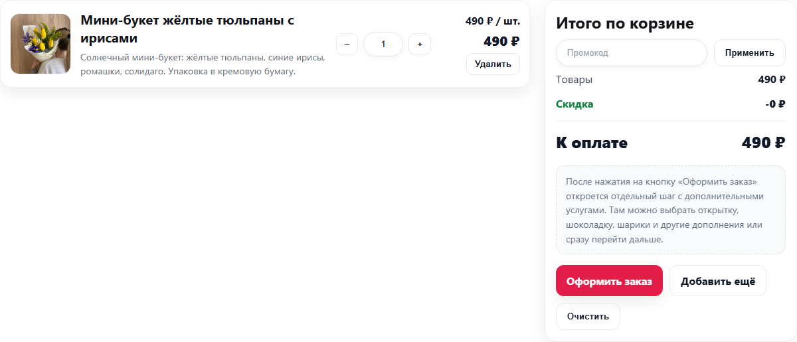
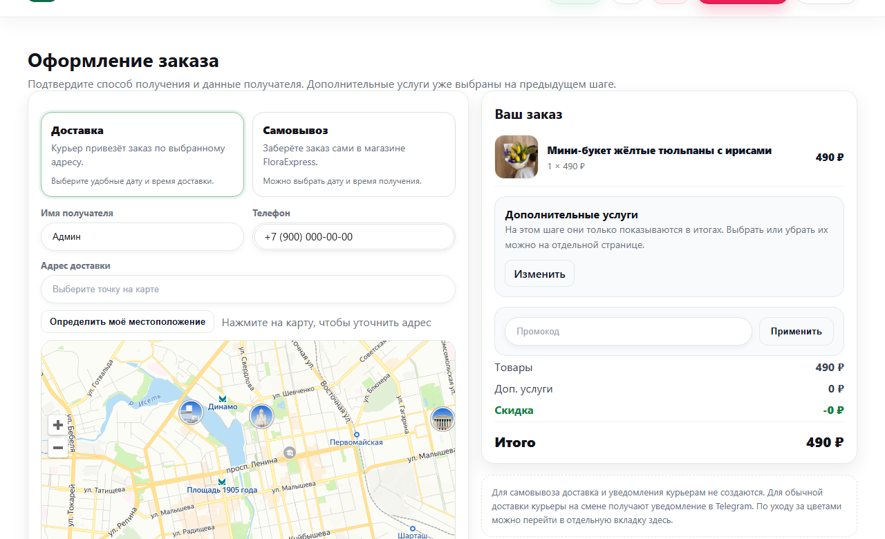
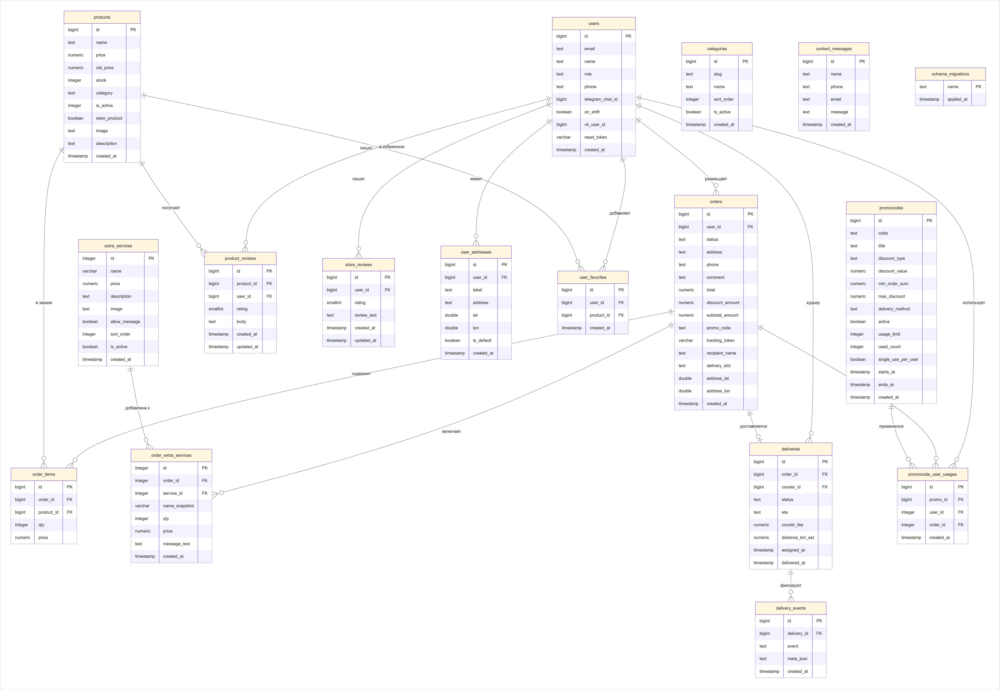

# FloraExpress — интернет-магазин цветов с доставкой

Выпускная квалификационная работа (ВКР), **УрГПУ, 2026**,
направление «Прикладная информатика в экономике».

Веб-приложение для цветочного магазина в Екатеринбурге: витрина и каталог, корзина,
оформление заказа с расчётом доставки по зонам на карте, личные кабинеты покупателя,
курьера и администратора, отчёты по продажам и уведомления персоналу в Telegram и VK.

Сайт работал на VPS. Сейчас хостинг отключён, поэтому живой демо-версии нет. Ниже есть
скриншоты и инструкция по локальному запуску.


## Возможности

**Покупатель**
- каталог с категориями, поиском, фильтром по цене и сортировкой; карточка товара с отзывами;
- избранное и корзина;
- оформление заказа: доставка или самовывоз, выбор точки на карте (Яндекс.Карты), дата и время доставки, дополнительные услуги (открытка, шары и т.п.), промокоды;
- стоимость доставки считается по зонам: расстояние от магазина, базовый тариф, цена за км, бесплатная доставка от суммы, надбавки по времени и праздникам;
- личный кабинет: история заказов, повтор заказа, адресная книга (с квартирой/подъездом/домофоном), профиль;
- отслеживание заказа по ссылке с токеном: статус, фото букета перед отправкой и положение курьера на карте;
- AI-консультант по подбору букета (YandexGPT, без ключа работает на правилах и справочнике «языка цветов»);
- регистрация с капчей и согласием на обработку ПДн, восстановление пароля по e-mail.

**Курьер**
- панель курьера: назначенные доставки, смена статусов;
- Telegram-бот и мини-приложение (Telegram WebApp): открытие и закрытие смены, уведомления о новых доставках, передача live-геолокации для отслеживания;
- уведомления через VK-бота (Callback API сообщества).

**Администратор / менеджер**
- заказы: список, карточка заказа, назначение курьера, статусы, загрузка фото букета для клиента;
- товары, категории, дополнительные услуги, промокоды;
- зоны доставки и тарифные модификаторы, ценовые правила (праздничные наценки, скидки);
- отчёты: выручка, средний чек, топ товаров, курьеры, графики (Chart.js), выгрузка в Excel;
- AI-разметка каталога (поводы, получатели, настроение) для консультанта, история AI-чатов;
- управление пользователями и ролями, журнал действий (audit log), просмотр схемы БД.

## Стек

| Слой | Технологии |
|---|---|
| Backend | PHP 8.1+ без фреймворков, PDO, сессии, CSRF-защита форм |
| База данных | PostgreSQL 14 |
| Frontend | HTML, CSS, ванильный JavaScript, Chart.js |
| Карты | API Яндекс.Карт, геокодирование адресов |
| Интеграции | Telegram Bot API и WebApp, VK Callback API, YandexGPT, SMTP |
| Сервер | Nginx + PHP-FPM (на проде), Apache `.htaccess` с закрытием служебных файлов |



## Скриншоты

| Каталог | Корзина |
|---|---|
|  |  |

**Оформление заказа с выбором адреса на карте**



**ER-диаграмма базы данных**



## Структура проекта

```
├── index.php, catalog.php, product.php, cart.php, checkout.php   — витрина и заказ
├── account*.php, order_view.php, track.php                       — личный кабинет, отслеживание
├── admin*.php, products.php, categories.php, promocodes.php ...  — админ-панель
├── courier_panel.php, webapp_courier*.php                        — кабинет и мини-приложение курьера
├── telegram_bot.php, vk_bot.php, *_notify.php                    — боты и уведомления
├── ai_advisor*.php, product_ai_tagging_lib.php                   — AI-консультант
├── *_lib.php, helpers.php, db.php, config.php, bootstrap.php     — бизнес-логика и инфраструктура
├── seed_*.php, import_*.php, migrate_schema.php                  — наполнение и миграции
├── config.local.example.php                                      — шаблон настроек (секреты)
├── database/   — schema.sql, патчи, полная схема в DBML
├── docs/       — ER-диаграмма и скриншоты
└── img/        — фотографии товаров
```

## Локальный запуск

Нужны **PHP 8.1+** с расширениями `pdo_pgsql`, `curl`, `gd`, `mbstring` и **PostgreSQL 14+**.

1. Создайте базу и базовые таблицы:
   ```bash
   createdb floraexpress
   psql -d floraexpress -f database/schema.sql
   ```
   Остальные таблицы (категории, промокоды, зоны доставки, отзывы и т.д.) приложение создаст
   само при первом обращении.

2. Скопируйте шаблон настроек и укажите доступ к БД:
   ```bash
   cp config.local.example.php config.local.php
   ```
   Ключи Яндекс.Карт, YandexGPT, токены ботов и SMTP необязательны: без них AI-консультант
   работает на правилах, а уведомления в Telegram/VK и письма просто не отправляются. Все настройки можно передать и переменными окружения
   (`DB_PASS`, `FLORA_BOT_TOKEN` и т.д.).

3. Запустите встроенный сервер PHP:
   ```bash
   php -S localhost:8000
   ```
   и откройте http://localhost:8000.

4. Зарегистрируйтесь на сайте и выдайте себе роль администратора:
   ```bash
   psql -d floraexpress -c "UPDATE users SET role = 'admin' WHERE email = 'you@example.com';"
   ```

5. Наполните справочники и каталог (под учёткой администратора откройте в браузере):
   `seed_delivery_zones.php`, `seed_pricing_rules.php`, `seed_flower_meanings.php`,
   `import_products.php`, `import_flowers.php`, `import_new_batch.php`.

> На боевом сервере эти служебные скрипты закрыты в `.htaccess` и запускаются только из консоли
> или временно. Встроенный сервер PHP `.htaccess` не читает, поэтому локально они доступны.

## Безопасность

- пароли хранятся через `password_hash`, все запросы к БД параметризованы (PDO prepared statements);
- CSRF-токены в формах, капча при регистрации, журнал действий администраторов и курьеров;
- секреты вынесены в `config.local.php` и переменные окружения, в репозитории их нет;
- `.htaccess` закрывает доступ к библиотекам, конфигам, миграциям, логам и служебным каталогам.

## Об авторе

Даниил Трофимов, выпускник УрГПУ 2026 года.
